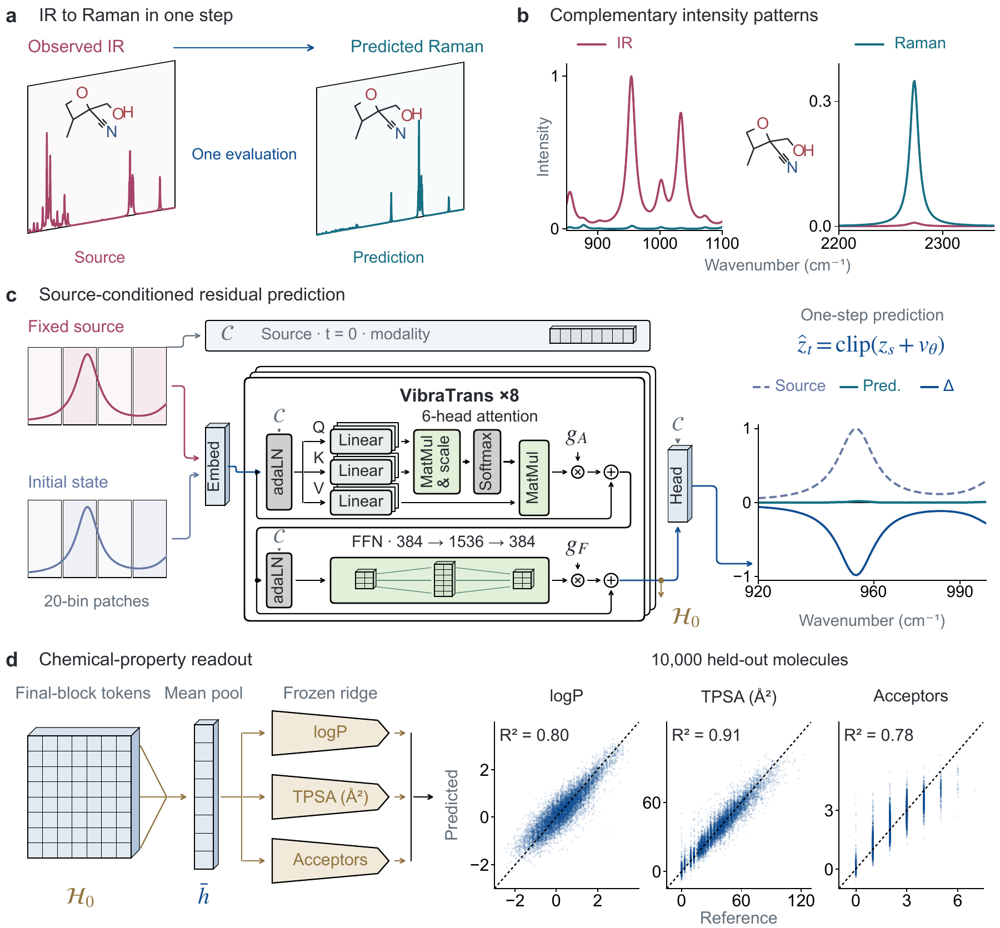
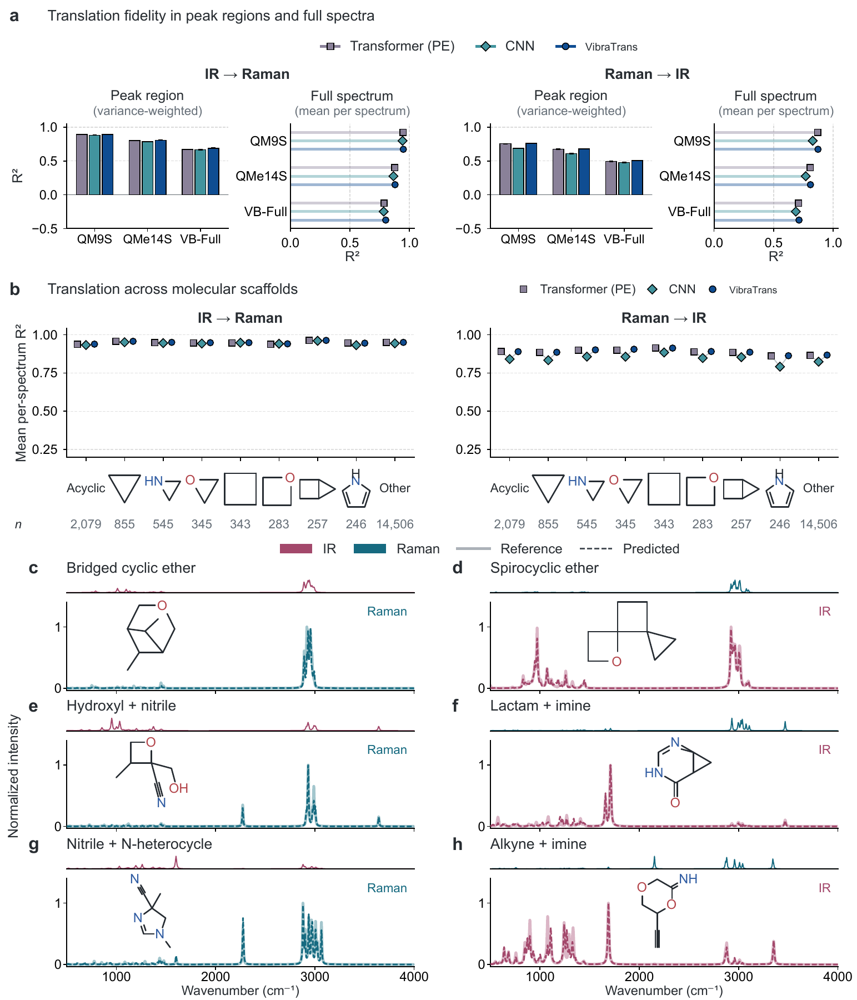
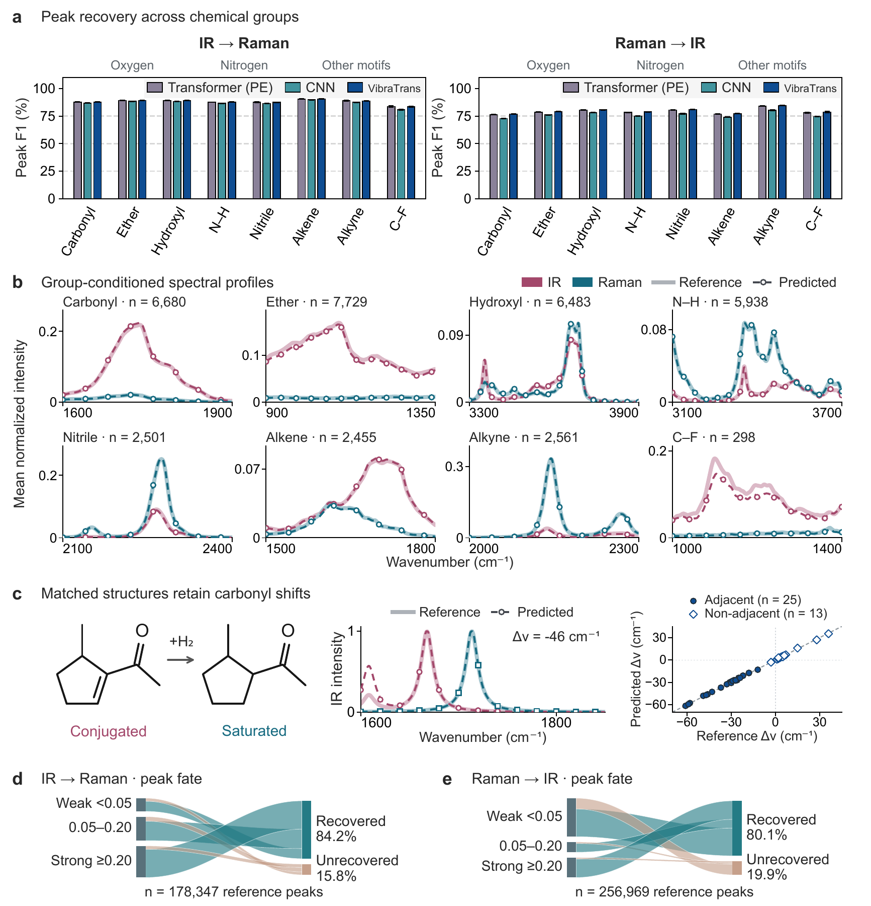
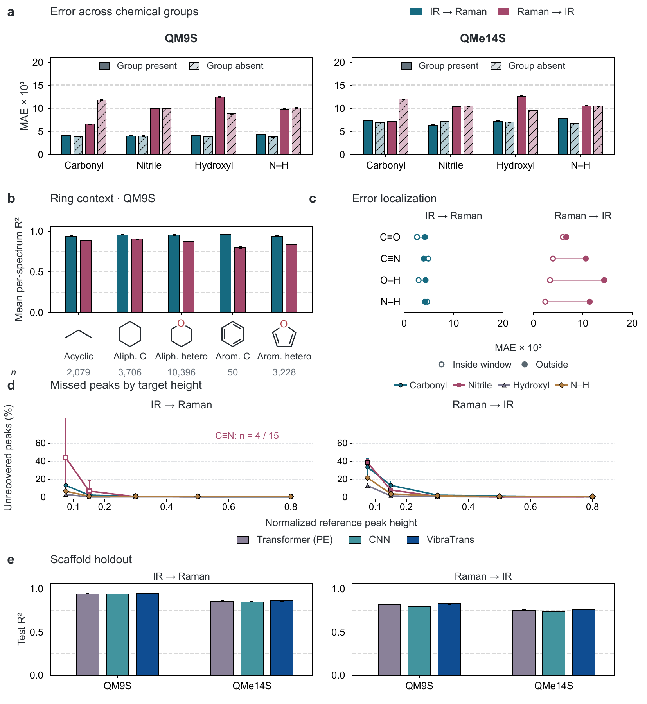
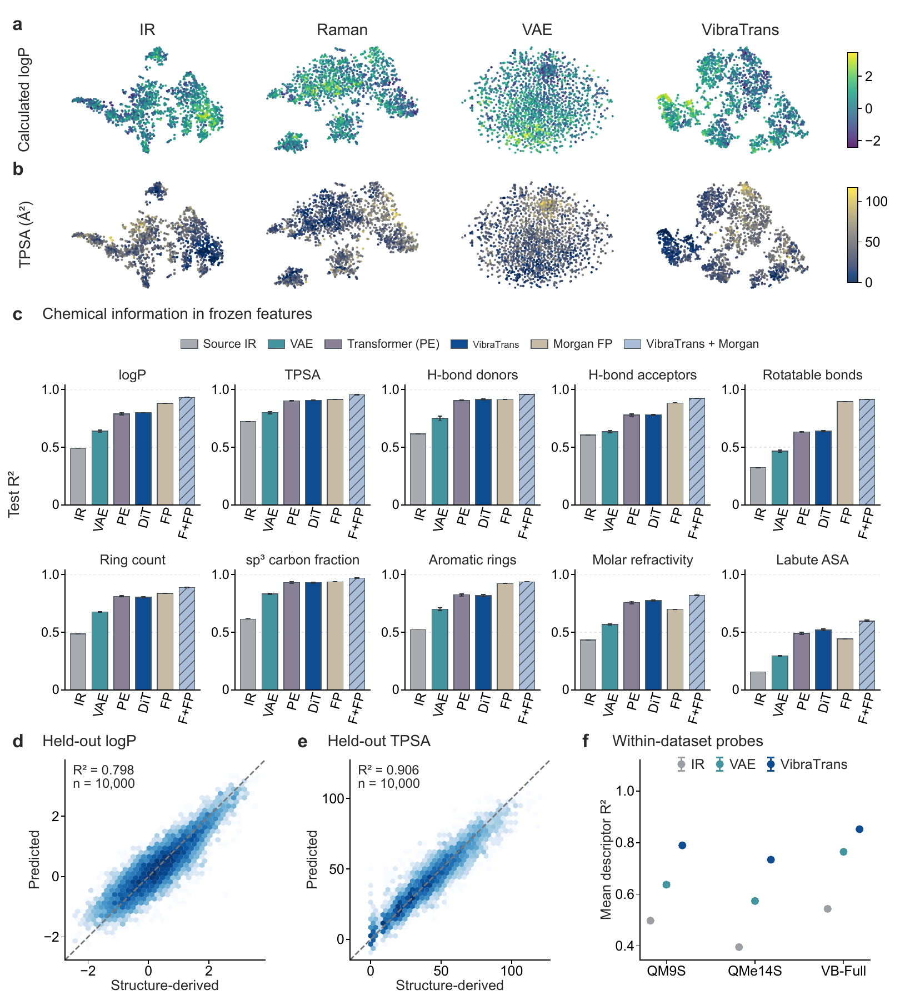

# VibraTrans

**Vibrational Spectra Translator: one-step infrared–Raman translation and molecular representation learning.**

VibraTrans predicts the complementary spectrum using only an input spectrum.
The final Transformer tokens also provide frozen molecular features. Molecular
structures are used for chemical interpretation and descriptor labels, not as
inputs to the translator. The manuscript evaluates **calculated molecular
spectra**; measured-spectrum deployment is not established by this release.

[](figures/Figure1.pdf)

## Install and run in minutes

Python 3.10+ and PyTorch 2.4+ are required. The core package depends only on
PyTorch and NumPy. A GPU is not needed for either example below.

```bash
git clone https://github.com/jiaqingxie/VibraTrans.git
cd VibraTrans
python -m venv .venv
source .venv/bin/activate
pip install torch --index-url https://download.pytorch.org/whl/cpu
pip install -e .
vibratrans demo --output-dir outputs/synthetic-demo
```

The offline demo generates small synthetic spectra, trains a reduced model for
four optimizer updates, reloads its checkpoint, exports predictions and frozen
features, and evaluates three held-out rows. Expected outputs are `(16, 83)`
predictions, `(16, 24)` features and a passing `demo_report.json`. It takes a few
seconds after installation on the tested CPU environment. **This checks the
workflow; its scores are not paper results.** Use a fresh output directory.

### Run the actual paper models

Three fixed QM9S test examples and expected outputs are included. The example
downloads the two seed-0 paper model weights (~183 MB total), verifies
their SHA256 hashes, predicts in both directions and checks the outputs and
frozen features against the supplied CPU references:

```bash
python examples/run_pretrained.py --download --output-dir outputs/qm9s-demo
```

For an offline run, place the two `.pt` assets from the
[v0.2.0 release](https://github.com/jiaqingxie/VibraTrans/releases/tag/v0.2.0)
in `checkpoints/` and omit `--download`. These are the first three rows in the
fixed test split, not selected success cases. See [example provenance](examples/qm9s/README.md).

## Reproduce a benchmark run

The release contains **120 primary task configurations**: three architectures,
two directions and four seeds in each of three molecular datasets and two
scaffold holdouts. Full arrays are obtained from their original providers using
the [data preparation guide](docs/data.md); exact splits and array hashes are
included. Use a CUDA-enabled PyTorch installation for full training.

```bash
vibratrans list-tasks
vibratrans verify-data --task qm9s_vibratrans_ir_seed0 --data-root /path/to/data --full-hash
vibratrans train --task qm9s_vibratrans_ir_seed0 --data-root /path/to/data --output-dir runs/qm9s_ir_seed0 --device cuda
vibratrans evaluate --task qm9s_vibratrans_ir_seed0 --data-root /path/to/data --checkpoint runs/qm9s_ir_seed0/best.pt --output-dir outputs/qm9s_test --device cuda
vibratrans predict --checkpoint runs/qm9s_ir_seed0/best.pt --input observed_ir.npy --output outputs/predicted_raman.npy --features-output outputs/features.npy --device cpu
```

Input arrays have shape `N × L` in native spectral order. Source and target are
independently min–max normalized. No molecular structure or target spectrum is
needed for `predict`. Training settings, baseline definitions and validation
selection are in [reproduction.md](docs/reproduction.md).

## Paper figures

Previews below link to the full-resolution vector PDFs in
[figures/](figures/); SHA256 checksums are listed in
[figures/manifest.json](figures/manifest.json). These are the five main
figures of the manuscript. Supplementary figures and tables are provided with
the manuscript rather than in this repository.

[](figures/Figure1.pdf)
*Figure 1. VibraTrans overview: one-step source-conditioned IR–Raman translation and frozen-feature descriptor prediction.*

[](figures/Figure2.pdf)
*Figure 2. Prediction accuracy across spectral regions (peak-region versus full-spectrum R²) and QM9S scaffold strata, with six fixed full-range examples.*

[](figures/Figure3.pdf)
*Figure 3. Functional-group mean spectra and whole-spectrum peak F1, matched-ketone carbonyl frequency shifts, and peak recovery grouped by source support.*

[](figures/Figure4.pdf)
*Figure 4. Error decomposition by functional group, ring class, diagnostic-window location and reference-peak height, with the scaffold-holdout comparison.*

[](figures/Figure5.pdf)
*Figure 5. Frozen final-block features: t-SNE organization, ten-descriptor ridge-probe R² across six representations, and logP/TPSA predictions.*

## Results and source data

- [All 120 primary per-seed results](results/benchmark.csv) and [checkpoint metadata](results/checkpoints.json).
- [Five main figure PDFs](figures/) and [figure checksums](figures/manifest.json).
- [Numerical source data](figures/source_data/) for main and supplementary analyses,
  including reported strict loss-ablation outcomes and the numerical failure.
- [Source-data index](figures/source_data/README.md) and [software review guide](docs/software-review.md).

Mean per-spectrum R² exceeds both primary baselines in all six primary
dataset–direction settings. MAE comparisons with the Transformer are mixed.
The computed datasets overlap chemically; QMe14S retains the documented
connectivity overlap. Model development used previously inspected partitions.
The supplementary three-term ablation is distinct from the final four-term recipe.

## Package layout

```text
src/vibratrans/  model, baselines, training, prediction, evaluation and CPU demo
configs/        120 primary tasks and five fixed splits
examples/       real QM9S test spectra, expected outputs and checkpoint example
tools/          original-data preparation and ViBench concatenation
results/        per-seed benchmark and selected-checkpoint metadata
figures/        current main figures and numerical source data
docs/           data sources, reproduction, software review and version history
tests/          workflow and scientific-protocol checks
```

For development: `pip install -e '.[analysis,dev]'`, then `pytest -q` and
`ruff check src tests examples`. The serialized architecture identifier
`vibradit` is retained inside recorded tasks for checkpoint compatibility;
the package, CLI, paper and repository are named **VibraTrans**.

The previous public version is preserved at
[archive/vibradit-20261021](https://github.com/jiaqingxie/VibraTrans/tree/archive/vibradit-20261021),
and the earlier SpectraFlow implementation at
[archive/spectraflow-20261003](https://github.com/jiaqingxie/VibraTrans/tree/archive/spectraflow-20261003).
See [version history](docs/history.md). The manuscript is under preparation.
